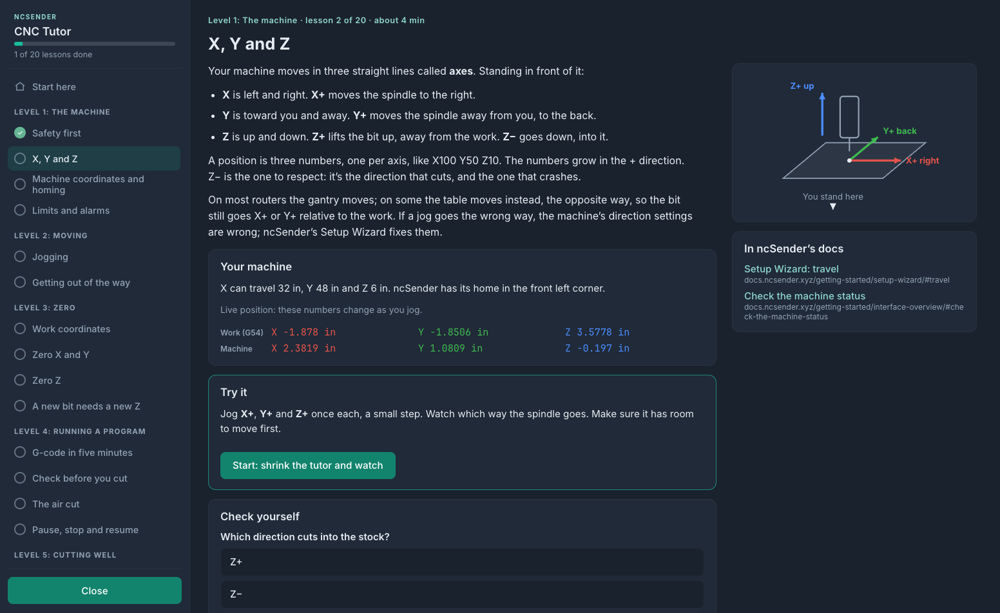

# CNC Tutor

An [ncSender](https://github.com/siganberg/ncSender) plugin that teaches a new operator the basics, one short
lesson at a time, **on their own machine**: from what X, Y and Z are to feeds and speeds.

Each lesson explains one idea in plain words with a picture, shows what your machine has (its travel, home
corner, limits, work offsets), then asks you to **try it in ncSender**: jog, home, zero. While you do, the
tutor shrinks to a small card in a corner and watches the machine: "X went up 10 mm: that's X+."

**The tutor never moves the machine or sends it anything.** You do every move yourself, in ncSender. The only
things it writes are its own progress, and (if you press the button) a short practice program loaded into the
visualizer, which doesn't run until you press Start.

## The lessons

| Level | Lessons |
| --- | --- |
| 1. The machine | Safety first · X, Y and Z · Machine coordinates and homing · Limits and alarms |
| 2. Moving | Jogging · Getting out of the way (Safe Z, Go to zero, Park) |
| 3. Zero | Work coordinates (G54–G59) · Zero X and Y · Zero Z · A new bit needs a new Z (tool length) |
| 4. Running a program | G-code in five minutes · Check before you cut · The air cut · Pause, stop and resume |
| 5. Cutting well | Bits · Feeds and speeds (with a chip load calculator and a table of your bits) · Depth of cut and stepover · Climb vs conventional · Holding the work |
| 6. Probing and tools | Changing a bit: the collet · How a probe works · The touch plate · The tool length setter · Tool changes and the ATC · The 3D probe |
| Your first part | A pocket in scrap with QuickCut, step by step, each step linked to its lesson |

Lessons for things your machine doesn't have set up in ncSender (a tool length setter, an ATC, a 3D probe) are
marked optional and say so. Lengths, feeds and the practice program follow ncSender's units, mm or inches.

Each lesson has a **Check yourself** quiz and links to the matching pages of
[ncSender's docs](https://docs.ncsender.xyz). On the kiosk screen, a link shows a QR code to open it on your phone.

Also: **Your machine** (its settings in plain words), **Where am I?** (the live state in words, and a map of the
table with the spindle and your work zeros), and a **Glossary**.

## Students on a shared machine

One student at a time. When the tutor opens it asks **Who's learning?**: pick your name to carry on where you
stopped, add yourself (a name is all it keeps), or continue as a guest (nothing saved). **Switch student** and
**Sign out** are in the sidebar, and after a 2-hour break it asks "Still you?". **Class progress** shows every
student's lessons, Try it steps, first-try quiz score and when they were last active.

## Try it: what the tutor watches for

| Lesson | It watches for |
| --- | --- |
| X, Y and Z | a jog of X+, Y+ and Z+ (one axis at a time) |
| Machine coordinates and homing | a homing cycle |
| Jogging | jogs of three different step sizes |
| Work coordinates | switching to another work offset and back (optional) |
| Zero X and Y, Zero Z | the active work offset's X and Y, or Z, changing |
| Check before you cut | the practice program loaded |
| The air cut | the practice program run to the end |
| Pause, stop and resume | a pause and a resume (optional) |
| How a probe works | the probe input coming on when you touch the plate to the bit |
| The touch plate | a probe from ncSender's Probe dialog that sets the zero |
| The tool length setter | a TLS measurement (optional) |
| Tool changes and the ATC | a tool change (optional) |

Keyboard jogging, a gamepad and the pendant work with the tutor open. To use ncSender's buttons, press
**Start** in the lesson's Try it: the tutor becomes a card you can move to any corner (**Move**), and ncSender
works behind it. **Back to the lesson** brings it back.

## The practice program

A 40 × 30 mm rectangle and a circle, 0.5 mm deep (1.5 × 1.25 in and 0.02 in deep on an inch machine), from X0 Y0 at its front-left corner with Z0
on the stock top. The G-code lesson reads it line by line, and Check before you cut and The air cut load it.

## Install

In ncSender: **Settings › Plugins**, install from the zip on the
[releases page](https://github.com/tmuka/ncsender-plugin-cnc-tutor/releases). Open it from the **Tools** menu.

## Credits and license

GPL-3.0. The starting feeds come from [QuickCut](https://github.com/siganberg/ncsender-plugin-quickcut)
(GPL-3.0). The lessons link to ncSender's documentation; none of its text is copied.
